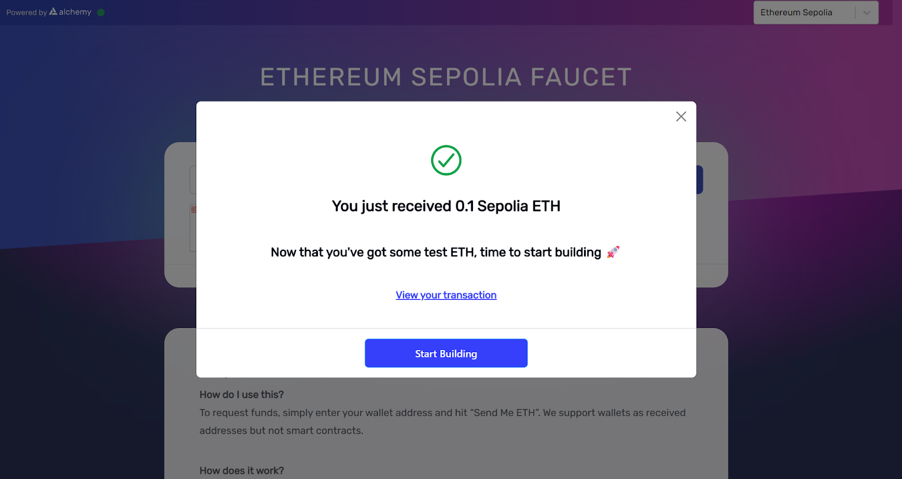

# TermMax Alpha 操作指南

> 在您开始阅读前请注意：本教程为动态更新版本。随着产品的优化与功能上线，内容将持续完善，请以最新版本为准。本教程同样适用于主网。

#### 什么是TermMax Alpha

TermMax Alpha 是将「固定利率借贷」升级为「期权式杠杆交易」的创新金融工具，让用户以可预测成本参与杠杆交易，且完全无清算风险。它打通了可控风险与杠杆交易之间的桥梁，让用户以更简单、更安全、更高效的方式获取收益。

**核心术语**

* **Maturity：**&#x671F;权到期日&#x20;
* **Strike Price ：**&#x662F;期权合约中约定的买入或卖出底层资产的价格，即行权价
* **Current Price ：**&#x5F53;前该代币在市场的价格
* **Premium：**&#x4FDD;费，买期权时支付的费用，就像“入场费”，同时也是用户在该仓位中可能损失的最大金额。
* **Underlying Asset:** 标的资产
* **Quote Asset:** 计价资产，用来表示标的资产价格的资产，包括行权价和结算价。常见的计价资产包括 USDT、WBNB 和 WETH。 

**核心玩法**

**Call（看涨）：**&#x5F53;您认为某个代币的价格会在未来上涨，您可以支付保费开多。若在到期日前，代币市价 > 行权价 → 用户获得收益；若在到期日前，代币市价 < 行权价，则仅损失保费，无清算风险。

**Put（看跌）：**&#x5F53;您认为某个代币的价格会在未来下跌，您可以支付保费做空。若在到期日前，代币市价 < 行权价 → 获利；若在到期日前，代币市价 > 行权价，用户则仅损失保费，无清算风险。

**Dual Investment（双币收益）：**&#x5B58;入标的资产或计价资产（USDT）到 Vault 中赚取收益，无论代币涨跌，用户都能获得相应收益（Premium）。其获得的收益会根据市场价格以及行权价格的变化，自动转换为该代币或计价资产。

#### 具体操作流程

**领取测试币**

前往 [ETH Faucet](https://www.alchemy.com/faucets/ethereum-sepolia)，输入以太坊钱包地址并获取测试 ETH；

<figure><figcaption></figcaption></figure>

进入 TermMax[ Faucet](https://termmax-app.testnet.ts.finance/faucet) 页面，点击 Mint Token 领取测试网目前支持的所有代币。

<figure><figcaption></figcaption></figure>

**做多Call/做空Put**

首先点击上方菜单 Alpha 进入[Call/Put](https://termmax-app.testnet.ts.finance/alpha/call-put) 界面；进入后选择你要做多（Call）或做空（Put）的代币。以下示例以 River 代币为例，计价资产为 USDT。&#x20;

<figure><figcaption></figcaption></figure>

\
**仓位逻辑**

| 仓位类型      | 支付 Premium（开仓成本/最大损失） | 提前关闭仓位收回资产（Close Position） | 获利结算收回资产（Take Profit） |
| --------- | --------------------- | -------------------------- | --------------------- |
| Call (看涨) | 标的资产（如 River）         | 标的资产（如 River）              | 计价资产（如 USDT）          |
| Put (看跌)  | 计价资产（如 USDT）          | 计价资产（如 USDT）               | 标的资产（如 River）         |

**做多Call**

1. **创建仓位**

当你看涨某个代币的未来表现时，希望能以行权价买入该代币并以市价卖出，则可以选择做多该代币。\
\
进入相应界面后，在 Amount 处输入你希望 Call 仓位覆盖的代币数量。假设输入 1000，则此时图中 Premium 显示的 River 数量为您需要支付的“保费”，也是这个仓位可能存在的最大损失。

<figure><figcaption></figcaption></figure>

2. **生成仓位：**&#x70B9;击 Submit 生成订单，左侧可查看仓位详情。

<figure><figcaption></figcaption></figure>

3. **收益与损失**

**止盈：**&#x82E5;在到期日前，市价>行权价，则用户能够获得相应的收益（ USDT）。当该仓位获得收益时，用户可点击‘Take Profit’获得收益，未产生收益时则无法点击该按钮。

<figure><figcaption></figcaption></figure>

\
**止损：**&#x82E5;在到期日前，市价<行权价，用户想要止损，则可选择‘Close Position’提前关闭仓位，点击 Submit 后，用户将收到剩余的 Premium，即相应的 River 代币。

<figure><figcaption></figcaption></figure>

\
**做空Put**

1. **创建仓位**

当你认为某一代币将在未来某一时间下跌时，希望能以行权价卖出该代币，则可以选择 Put 做空该代币。在 Amount 处输入你希望 Put 仓位覆盖的代币数量。\
\
假设输入 50，则此时图中 Premium 显示的 USDT 金额则为你需要支付的保费，也是这个仓位可能存在的最大损失。

<figure><figcaption></figcaption></figure>

2. **生成仓位：**&#x70B9;击 Submit 生成订单，左侧可查看仓位详情。

<figure><figcaption></figcaption></figure>

3. **收益与损失**

**止盈：**&#x82E5;在到期日前，市价<行权价，则用户能够获得相应的收益（ River Token）。当该仓位获得收益时，用户可点击‘Take Profit’获得收益，未产生收益时则无法点击该按钮。

<figure><figcaption></figcaption></figure>

**止损：**&#x82E5;在到期日前，市价>行权价，用户想要止损，则可选择‘Close Position’提前关闭仓位，点击 Submit 后，用户将收到剩余的 Premium，即相应的 USDT。

<figure><figcaption></figcaption></figure>

**Dual Investment**

无论你手上持有标的资产还是计价资产， 都能以相应的 Strike Price 存入对应的 Vault 中来获得收益。无论代币价格在有效期内如何变化，用户都能获得 Premium 收益。（获得的收益会根据市场价格以及行权价格的变化，自动转换为该代币或计价资产。）\
\
同样以 River 为例。用户既可以选择存入 River Token，也可以选择存入 USDT。

<figure><figcaption></figcaption></figure>

1. 选择 **Deposit River**，则意味着以 $9.36 行权价存入资产。在有效期截止前，此时有两种情况： 

* River 市价低于行权价（< Strike) → 用户保留 Token 并获得保费（Premium），以 Token 形式支付
* River 市价高于行权价（> Strike) → 用户收到 USDT 并获得保费（Premium），以 USDT 形式支付

2. 选择 **Deposit USDT**，则意味着以 $5.04 行权价存入稳定资产。此时也有两种情况： 

* River 市价低于行权价（< Strike） → 收到 Token 并获得保费（Premium），以 Token 形式支付
* River 市价高于行权价（> Strike） → 保留 USDT 并获得保费（Premium），以 USDT 形式支付 

无论上述哪种情况，用户最终都能得到相应的 Premium。用户可点击 Dashboard 查看 Vault 情况。

<figure><figcaption></figcaption></figure>

3.  用户如何在到期前赎回资产？\
    前往 Dashboard 并在 Vault 中找到相应的 Dual Investment 仓位。用户在到期前可以继续存入资产或选择以标的资产或计价资产进行赎回。 

    <figure><figcaption></figcaption></figure>

