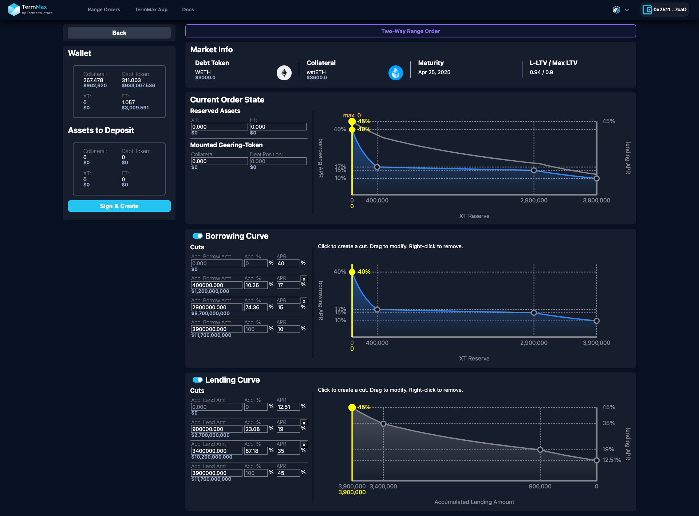

# 范围订单工具

### 范围订单工具简介

TermMax 范围订单工具专为交易者设计，支持根据市场行情动态设置借贷利率。该工具使借款人、出借人及交易者能够自由调整流动性分布与利率水平，从而最大化资金效率并增强市场竞争力。

### 自定义范围订单的核心优势

✅ 灵活的借贷市场设计

* 区别于传统自动化做市商（AMM）的固定定价机制，TermMax 范围订单工具允许交易者自由构建利率曲线和流动性分布，提供更多套利和收益优化机会。

✅ 图形化界面，辅助高效决策

* 区别于传统自动化做市商（AMM）的固定定价机制，TermMax 范围订单工具允许交易者自由构建利率曲线和流动性分布，提供更多套利和收益优化机会。

✅ 适应市场动态，灵活调整利率

交易者可根据市场实时供需情况调整借贷利率，从而灵活应对流动性变化，最大化市场份额。

### 创建新订单

进入范围订单工具用户界面后，首先确认右上角显示的是您希望使用的地址及区块链网络。

<figure><figcaption></figcaption></figure>

点击“创建新订单”按钮后，即可选择市场。

<figure><figcaption></figcaption></figure>

选择市场创建范围订单：

<figure><figcaption></figcaption></figure>

选择市场后，将出现三个选项：“借贷范围订单”、“借款范围订单”和“高级模式”（您可以在高级模式中配置双向范围订单）。

<figure><figcaption></figcaption></figure>

### 配置范围订单

#### 借贷范围订单

选择借贷范围订单后，您可以开始配置设置：

<figure><figcaption></figcaption></figure>

**市场信息**

市场信息部分为范围订单设定者提供关键细节，包括：

* 债务代币：借出资产类型，例如 USDT。
* 抵押品：抵押资产类型，例如 sUSDe。
* 到期日：贷款的固定到期日，例如 2025年3月28日。
* 贷款价值比（LTV）：显示当前的贷款对抵押品的价值比率，例如 0.82。

这些信息帮助范围订单设定者了解市场条件并设计适当的借贷策略。

**借贷曲线**

借贷曲线部分允许放款者为不同贷款金额设定不同的利率（APR），提供了一个灵活的借贷率管理工具：

* 累计借贷金额：显示随总借款额增加而变化的利率。
* 累计借贷百分比（Acc. %）：表示市场流动性总额中订单设定者所提供的比例。
* 年利率（APR）：允许订单设定者为不同的累计借贷金额范围定义固定利率。
* 开关：订单设定者可以点击此图标以启用或禁用订单，使他们能够根据市场条件迅速激活或暂停借贷。

如何调整切点和范围订单：

1. 点击图表中的切点（节点）添加或修改借贷利率区段。
2. 拖动节点调整流动性分配并优化资本效率。
3. 如果您想暂停订单，点击开关禁用它。市场条件有利时可以重新激活。

此功能使订单设定者能够根据需求动态管理资本，最大化利润同时减少风险。

**当前订单状态（Current Order State）**

此部分显示订单设定者当前的订单状态，包括：

* 借贷能力（Lending Capacity）：订单设定者目前愿意借出的债务代币数量。
* 可认领（Claimable）：订单设定者目前持有的未到期固定收益代币（FT）数量。每个 FT 代表一个在到期日可兑换的债务代币。

<figure><figcaption></figcaption></figure>

此外，当订单设定者输入新的借贷能力（例如，250）时，界面会显示两条参考线：

* 实线黄线（29.86% APR）：代表新的借贷能力（250）及其在当前市场曲线下对应的借贷利率。
* 虚线灰线（35.03% APR）：代表先前借贷能力的利率，帮助订单设定者比较变化如何影响市场。

这些指标帮助订单设定者实时监控市场反应并相应调整其策略。

#### 借款范围订单

借款曲线部分允许借款者为不同贷款规模设定可变年利率（APR），提供更精细的利率管理机制：

* 累计借款金额：显示不同借款金额的对应利率。
* 累计借款百分比（Acc. %）：代表借款者在市场流动性中的份额。
* 借款年利率（APR）：市场借款利率，随借款金额的变化而调整。
* 曲线：可视化贷款金额与利率之间的关系，帮助借款者做出最优决策。
* 切点（节点）：借款者可以点击并拖动节点动态添加或修改 APR 调整。

如何调整切点和范围订单：

1. 点击图表中的切点（节点）设定不同借款金额及其对应的 APR。
2. 拖动节点来微调借款利率曲线，优化借款成本。
3. 根据市场动态调整曲线，以获得最佳借款条款。

<figure><figcaption></figcaption></figure>

#### 当前订单状态

该部分显示借款者当前的贷款位置和订单状态，包括：

* 安装的传动装置代币（GT）：显示与杠杆相关的借款细节：
  * 抵押品（已存入的抵押资产金额）。
  * 债务头寸（借入资金金额）。
*   订单状态：

    * 借款能力：借款者目前可以借款的最大金额。

此外，当借款者输入新的借款能力（例如，345,000 sUSDe，相当于400,000 USDT）时，界面会显示两条参考线：

* 实心黄线：代表新的借款能力及其在当前市场曲线下的对应借款利率。
* 例如，当借款者借出400,000债务代币时，订单的借款利率将下调至17%，与借款曲线中设定的利率一致。这确保了借款成本随着借款者增加债务而动态调整，遵循预定义的利率结构。

这些视觉指示器帮助借款者监控市场动态并优化他们的借款策略。

#### 双向范围订单

<figure><figcaption></figcaption></figure>

**借款曲线**

* 随着借款金额的变化动态调整借款利率。
* 随着更多资金的借入，借款利率降低。
* 在借入400,000债务代币时，利率降至17%，优化借款成本。

**借贷曲线**

* 根据累计借出金额设定借贷利率。
* 在借出3,400,000债务代币时，利率提高至35%，最大化借贷收益。

通过战略性设定借贷利率，订单设定者可以在适应市场条件的同时赚取利差。

**当前订单状态**

该部分显示订单设定者的实时位置状态，包括：

* 预留资产：
  * XT（杠杆化位置资产）。
  * FT（固定收入代币）。
* 已配置的杠杆代币：
  * 抵押品（作为抵押金存入的资产）。
  * 债务头寸（当前借入金额）。
* 订单状态：
  * 借款能力：可用于借款的最大金额。
  * 借贷能力：可供借出的债务代币量。

