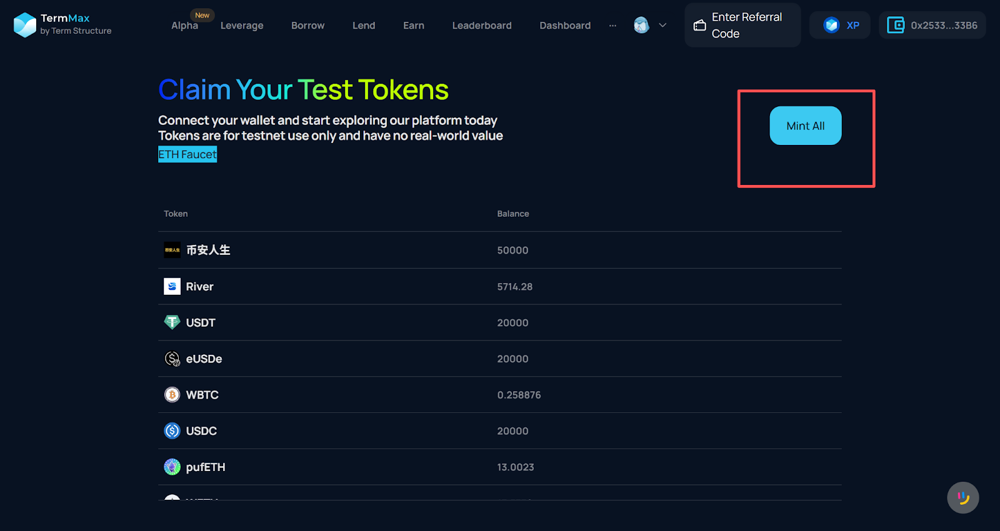

# How to Use TermMax Alpha Testnet

> This tutorial is a dynamic version. Content will be continuously updated as product optimizations and features are released. Please refer to the latest version. This tutorial is also applicable to the Mainnet.

### What is TermMax Alpha

TermMax Alpha is an innovative financial instrument that transforms "fixed-rate lending" into **"options-like leveraged trading,"** allowing users to participate in leveraged trading at a **predictable cost** and completely **without liquidation risk**.&#x20;

It bridges the gap between controlled risk and leveraged trading, enabling users to generate yield in a simpler, safer, and more efficient manner.

### Terminology

* Maturity: The expiry date of the option contract.
* Underlying Asset: The asset on which the option is based.&#x20;
* Quote Asset: The asset in which the underlying asset’s price — including strike and settlement — is expressed. Common quote assets include USDT, WBNB, and WETH.
* Strike Price: The agreed-upon price in the option contract at which the underlying asset can be bought or sold.
* Current Price: The current market price of an option's underlying asset.
* Premium: The fee paid to purchase the option, acting as an "entry fee," and representing the maximum amount a user can lose on that position.

### Core Mechanics

* **Call (Long/Bullish)**\
  When you expect a token’s price to rise, you can pay a premium to go long (open a Call position).\
  \
  If before expiry the market price > strike price → you earn profit.\
  If the market price < strike price → you only lose the premium (no liquidation risk). 
* **Put (Short/Bearish)**\
  When you expect a token’s price to fall, you can pay a premium to short (open a Put position).\
  \
  If before expiry the market price < strike price → you earn profit.\
  If the market price > strike price → you only lose the premium (no liquidation risk). 
* **Dual Investment**\
  Deposit either an underlying token or a quote asset (like USDT) into a Vault to earn yields, regardless of market direction. Your return (Premium) is automatically settled in underlying or quote assets, depending on the market and strike price movement.

### Step-by-Step Guide

#### Claim Test Tokens

1. Go to the [ETH Fauce](https://www.alchemy.com/faucets/ethereum-sepolia)t, enter your Ethereum wallet address, and claim test ETH.

<figure><figcaption></figcaption></figure>

2. Navigate to the [TermMax Faucet](https://termmax-app.testnet.ts.finance/faucet) page, click "Mint Token" to claim all tokens currently supported on the testnet.

<figure><figcaption></figcaption></figure>

#### Opening Call (Long) / Put (Short) Positions

1. First, click "Alpha" in the top menu to enter the [Call/Put](https://termmax-app.testnet.ts.finance/alpha/call-put) interface.
2. Select the token you wish to go long (Call) or short (Put) on. The example below uses the River token.

<figure><figcaption></figcaption></figure>

**Position Logic (Asset Flow)**

The following table outlines the asset used for payment (Premium) and the asset received upon closing or profiting:

| Position Type | Pay Premium (Opening Cost / Max Loss) | Close Position Receives       | Take Profit Receives           |
| ------------- | ------------------------------------- | ----------------------------- | ------------------------------ |
| Call (Long)   | Underlying Asset(e.g., River)         | Underlying Asset(e.g., River) | Quote Asset (e.g. USDT)        |
| Put (Short)   | Quote Asset (e.g. USDT)               | Quote Asset (e.g. USDT)       | Underlying Asset (e.g., River) |

**Call (Long)**

**Create Position:** When you are bullish on a token's future performance and wish to buy the token at the Strike Price to sell at a higher Current Price, select Call for that token.

* In the interface, enter the Amount (the quantity of tokens the Call position covers). If you input 1000, the Premium displayed (in River quantity) represents the fee you must pay, which corresponds to the maximum possible loss for this position.

<figure><figcaption></figcaption></figure>

**Generate Position:** Click "Submit" to generate the order. You can view the position details on the left.         &#x20;

<figure><figcaption></figcaption></figure>

**Profit and Loss:**

* **Profit Scenario:** If the Current Price > Strike Price before maturity, the user will profit (received in USDT). The user can click "Take Profit" to realize the gains. If no profit has occurred, the button will be inactive.

<figure><figcaption></figcaption></figure>

* **Stop-Loss Scenario:** If the Current Price < Strike Price, and the user wishes to cut losses, they can select "Close Position" to close the position early. After clicking "Submit," the user will receive the remaining Premium back in the corresponding River token.

<figure><figcaption></figcaption></figure>

**Put (Short)**

**Create Position:** When you believe a token's price will fall at a future date and wish to sell the token at the Strike Price, select Put for that token.

* In the Amount field, enter the quantity of tokens the Put position covers. If you input 50, the Premium displayed (in USDT) is the fee you must pay, which is the maximum possible loss for this position.

<figure><figcaption></figcaption></figure>

**Generate Position:** Click "Submit" to generate the order. You can view the position details on the left.       &#x20;

<figure><figcaption></figcaption></figure>

**Profit and Loss:**

* **Profit Scenario:** If the Current Price < Strike Price before maturity, the user will profit (receive in the underlying asset). The user can click "Take Profit" to realize the gains. If no profit has occurred, the button will be inactive.

<figure><figcaption></figcaption></figure>

* **Stop-Loss Scenario:** If the Current Price > Strike Price, and the user wishes to cut losses, they can select "Close Position" to close the position early. After clicking "Submit," the user will receive the remaining Premium back in the corresponding USDT.

<figure><figcaption></figcaption></figure>

#### Dual Investment

Deposit either the underlying asset or the quote asset into a Vault to earn yield. Regardless of the token's price movement, the user earns an expected Premium return. T**he return received will be automatically converted into either the underlying or quoted asset, depending on the changes in the Current Price and the Strike Price**.\
\
Users can choose any market on our testnet. Below, we will use River as an example.

<figure><figcaption></figcaption></figure>

Select **Deposit River** means depositing the asset at a Strike Price (e.g., $9.36). There are two scenarios:

* River Price < Strike: User retains the Token and receives the Premium, paid in Token form.
* River Price > Strike: User receives USDT equivalent and receives the Premium, paid in USDT form.

Select **Deposit USDT** means depositing USDT at a Strike Price (e.g., $5.04). There are two scenarios:

* River Price < Strike: User receives the Token equivalent and receives the Premium, paid in Token form.
* River Price > Strike: User retains the USDT and receives the Premium, paid in USDT form.

In all scenarios above, the user ultimately receives the corresponding Premium. Users can check their Vault status by clicking **"Dashboard."**  &#x20;

<figure><figcaption></figcaption></figure>

#### How to Withdraw Assets Before Maturity?

Users can go to the Dashboard and find the corresponding Dual Investment position in the Vault. Before maturity, users can continue to deposit assets or choose to withdraw using the underlying asset or the quote asset.

<figure><figcaption></figcaption></figure>
