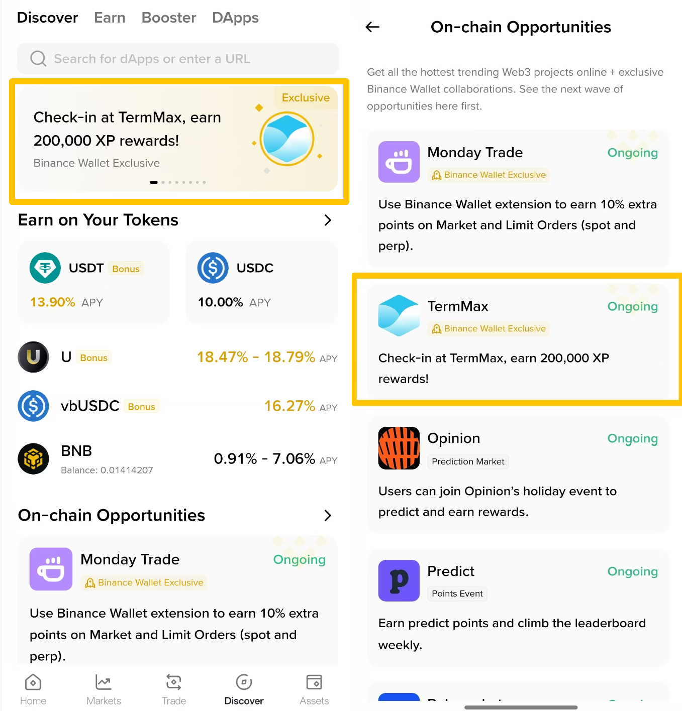
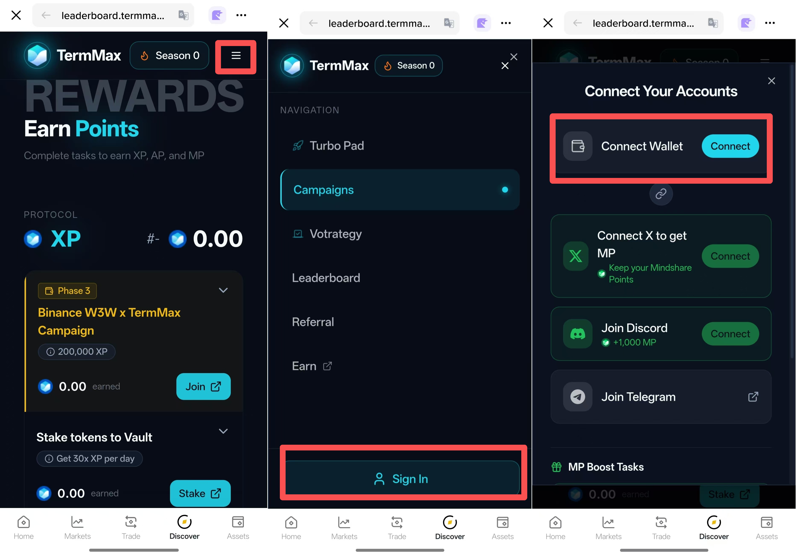
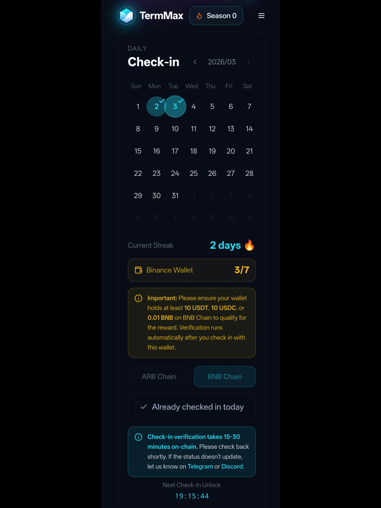
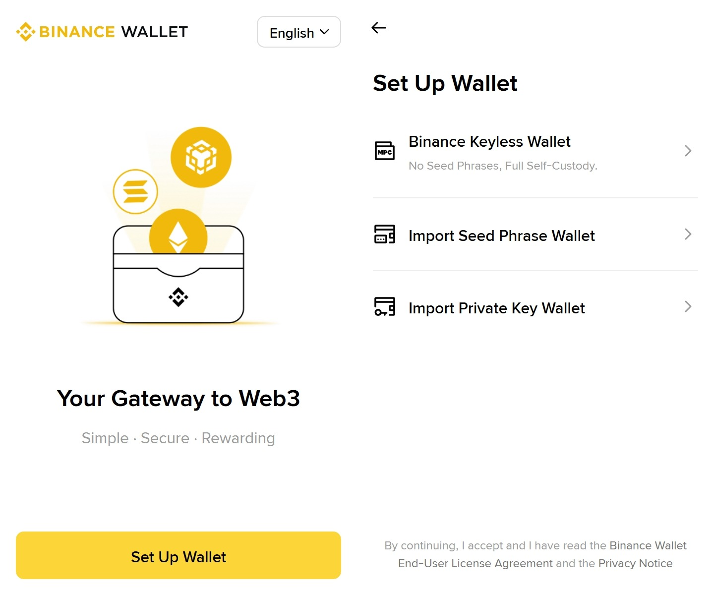

# 🥳 【Tutorial】Binance Wallet Campaign Round 2: Complete 7 Days of Check-ins to Unlock 200K XP!

> <mark style="color:$warning;">**Note:**</mark> \
> <mark style="color:$info;">Badges and XP rewards will be distributed after the campaign ends.</mark>\
> For any general inquiries or project/campaign details, please join [**our official Discord**](https://discord.gg/8rKj2DZ59k)**.** If you encounter any campaign-related issues, please open a support ticket in the server.

## Campaign Period

March 4, 08:00 UTC – March 18, 07:59 UTC

## What to Do & What You’ll Get

### Requirements

* Connect your Binance Wallet on the Leaderboard page via the [**Binance Wallet Browser Extension**](https://chromewebstore.google.com/detail/binance-wallet/cadiboklkpojfamcoggejbbdjcoiljjk?utm_medium=sdk\&utm_source=leaderboard.termmax.ts.finance) **(desktop)** or [**Binance App**](https://app.binance.com/uni-qr/web3-onchain-opportunities?utm_campaign=termmax) **(mobile)**.&#x20;
* Check in on any 7 days (not necessarily consecutive) on BNB Chain during the campaign using the Binance Wallet.
* Make sure your wallet holds ≥10 USDC/USDT, or ≥0.01 BNB on BNB Chain during the campaign period.

### Rewards

* **For every eligible user:** In addition to 300 XP for each check-in (2,100 XP total for 7 days), an exclusive Binance W3W Adopter Badge and 200,000 XP will be unlocked within approximately one day after the campaign ends upon meeting the requirements.



1. Even if you complete the check-in, your Binance Wallet check-in count won’t update if any of the requirements above are not met.
2. The Binance Wallet check-in count may take 15–30 minutes to update due to on-chain processing. Kindly check back shortly.



<mark style="color:$warning;">**To learn more about XP, see:**</mark>\
[https://x.com/TermMaxFi/status/1998320208755515614?s=20](https://x.com/TermMaxFi/status/1998320208755515614?s=20)&#x20;

## Step by step guide

### Mobile (Binance App)

Make sure you’ve downloaded the [Binance App](https://app.binance.com/uni-qr/web3-onchain-opportunities?utm_campaign=termmax).

#### Step 1: Open the Binance App and go to the Binance Wallet tab

#### Step 2: Add your wallet address&#x20;

Create a keyless wallet or import an existing wallet. If you already have a Binance Wallet address, you can skip this step.&#x20;

<figure><figcaption></figcaption></figure>

#### Step 3: Go to the Discover tab and find TermMax

Find the **campaign banner** at the top of the Discover main page and click on it, or go to the **On-chain Opportunities** section to access TermMax.

<figure><figcaption></figcaption></figure>

#### Step 4: Connect to the leaderboard page

<figure><figcaption></figcaption></figure>

#### Step 5: Begin your daily check-ins and earn XP!

After successfully signing in to the Leaderboard page, scroll down to the **Daily Check-in** section to complete your check-in.\
\
Please note that the Binance Wallet check-in count may take 15–30 minutes to update due to on-chain processing. Kindly check back shortly.\
\
If your Binance Wallet check-in count isn’t updating, it may be because you haven’t met all the requirements listed above. Please make sure you meet them.

<figure><figcaption></figcaption></figure>

### Desktop (Browser Extension)

#### Step 1: Visit the website[ https://leaderboard.termmax.ts.finance/](https://leaderboard.termmax.ts.finance/)

#### Step 2: Click “Sign in”

<figure><figcaption></figcaption></figure>

#### Step 3: Connect Wallet

<figure><figcaption></figcaption></figure>

#### Step 4: Choose Binance Wallet and Install the Extension

Install the [Binance Wallet extension](https://chromewebstore.google.com/detail/binance-wallet/cadiboklkpojfamcoggejbbdjcoiljjk?utm_medium=sdk\&utm_source=leaderboard.termmax.ts.finance), set up your wallet (you can import any wallet using keyless, seed phrase, or private key), and then connect.&#x20;

<figure><figcaption></figcaption></figure>

<figure><figcaption></figcaption></figure>

#### Step 5: Wallet connected!

<figure><figcaption></figcaption></figure>

#### Step 6: Begin your daily check-ins and earn XP!

Scroll down the campaign page to find the check-in section and select **BNB Chain** to check in. \
\
Please note that the Binance Wallet check-in count may take 15–30 minutes to update due to on-chain processing. Kindly check back shortly.\
\
If your Binance Wallet check-in count isn’t updating, it may be because you haven’t met all the requirements listed above. Please make sure you meet them.

<figure><figcaption></figcaption></figure>

<figure><figcaption></figcaption></figure>

### &#x20;Check your XP and Badge

You can check your XP in the section shown in the screenshot. Please note that the 300 XP for each check-in may take some time to sync after completing a check-in.\
\
Once the requirements are met, the corresponding rewards will be distributed within approximately one day after the campaign ends.\
\
You can see your badge in the Badge Collection section.

<figure><figcaption></figcaption></figure>

<figure><figcaption></figcaption></figure>
