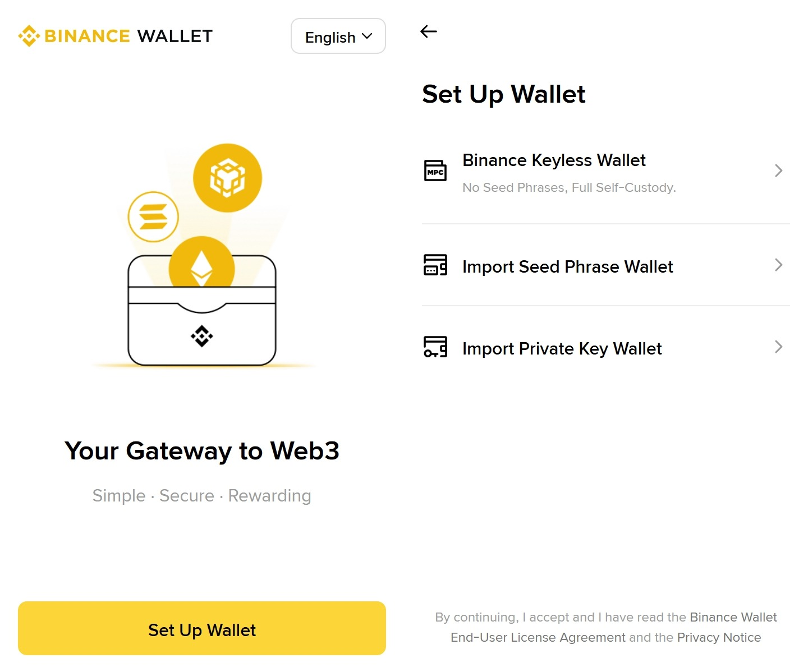

# 🤩 【Tutorial】Complete a 5-Day consecutive Binance Wallet Check-in to unlock exclusive rewards!

### Campaign ends

2026/02/12 15:59 UTC+8

### What to Do & What You’ll Get

#### Requirements

* Connect your Binance Wallet via the [Binance Wallet extension](https://chromewebstore.google.com/detail/binance-wallet/cadiboklkpojfamcoggejbbdjcoiljjk?utm_medium=sdk\&utm_source=leaderboard.termmax.ts.finance)
* Check in with the Binance Wallet extension for 5 consecutive days on BNB Chain
* Make sure you hold ≥10 USDC, ≥10 USDT, or ≥0.01 BNB in your wallet on BNB Chain throughout the 5-day check-in period.&#x20;

#### Rewards

* **All users:** In addition to 300 XP for each check-in (1,500 XP total for 5 days), an exclusive Binance W3W Early Adopter Badge and 200,000 XP are unlocked upon meeting the requirements.
* **Newbie Bonus:** If you're completely new to TermMax, checking in with Binance Wallet for 5 consecutive days will also unlock the Streak Chaser Badge and 50,000 XP — a little extra treat for first-timers! That brings your total to 251,500 XP.



1. The Binance Wallet check-in must be completed on <mark style="color:$warning;">**desktop**</mark> via the **Binance Wallet browser extension**. If you see **“Unavailable”** after clicking in, it may be due to regional restrictions. You can try switching to a different VPN node.
2. The points and check-in status <mark style="color:$warning;">**may take some time to sync**</mark> after each check-in. After completing the check-in, make sure the status shows '**Already checked in today'.**
3. Even if you complete the check-in, your <mark style="color:$warning;">**Binance Wallet Streak will not increase**</mark> if your **wallet balance does not meet the requirements** above or if you **did not use the Binance Wallet desktop browser extension**.



<mark style="color:$warning;">**To learn more about XP, see:**</mark>\
[https://x.com/TermMaxFi/status/1998320208755515614?s=20](https://x.com/TermMaxFi/status/1998320208755515614?s=20)&#x20;

### Step by step guide

#### Step 1: Visit the website[ https://leaderboard.termmax.ts.finance/](https://leaderboard.termmax.ts.finance/)

#### Step 2: Click “Sign in”

<figure><figcaption></figcaption></figure>

#### Step 3: Connect Wallet

<figure><figcaption></figcaption></figure>

#### Step 4: Choose Binance Wallet

Install the [Binance Wallet extension](https://chromewebstore.google.com/detail/binance-wallet/cadiboklkpojfamcoggejbbdjcoiljjk?utm_medium=sdk\&utm_source=leaderboard.termmax.ts.finance), set up your wallet, and then connect.\
\
Please note that you MUST use the Binance Wallet browser extension to meet the requirements, logging in by scanning the QR code via the Binance app is not eligible.

<figure><figcaption></figcaption></figure>

<figure><figcaption></figcaption></figure>

#### Step 5: Wallet connected!

<figure><figcaption></figcaption></figure>

#### Step 6: Begin your daily check-ins and earn XP!

Scroll down the campaign page to find the check-in section, and <mark style="color:$warning;">**select BNB Chain**</mark> to check in. It may take a moment for your status to update, so please make sure it shows “<mark style="color:$warning;">**Already checked in today**</mark>”. This indicates that your check-in was successful.

<figure><figcaption></figcaption></figure>

<figure><figcaption></figcaption></figure>

#### Step 7: Check your XP and Badge

You can check your XP in the section shown in the screenshot. Please note that the 300 XP for each check-in may take some time to sync after completing a check-in.\
\
Once the requirements are met, the corresponding rewards will be distributed within approximately one day after the campaign ends.\
\
You can see your badge in the Badge Collection section.

<figure><figcaption></figcaption></figure>

<figure><figcaption></figcaption></figure>
