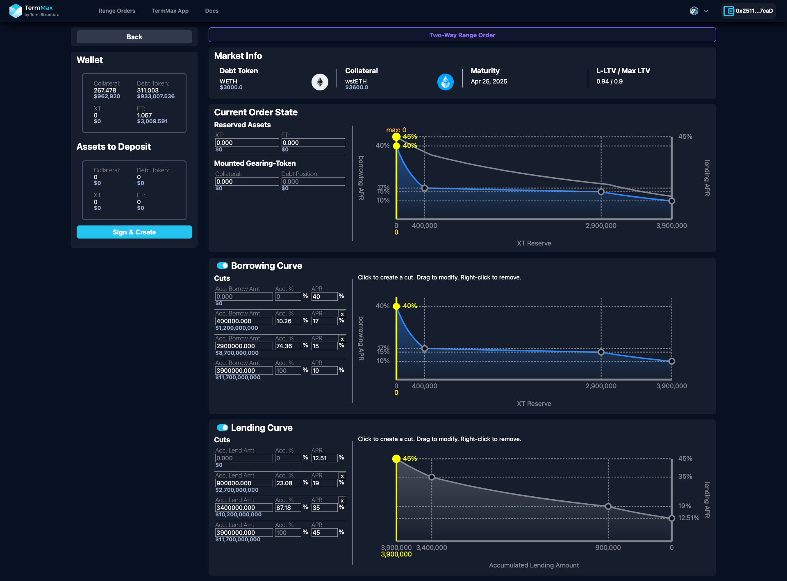

# Range Order Tool

### Range Order **Tool Introduction**

The TermMax Range Order Tool is designed for traders to set borrowing and/or lending rates dynamically based on market conditions. This tool enables borrowers, lenders and traders to freely adjust liquidity distribution and interest rate levels, maximizing capital efficiency and market competitiveness.

### Key Advantages of Custom Range Orders

✅ Flexible Lending Market Design

* Unlike traditional AMMs with fixed pricing formulas, TermMax Range Order Tool allows traders to freely structure interest rates and liquidity, providing more opportunities for arbitrage and yield optimization.

✅ Visual Adjustments for Efficient Decision-Making

* With an intuitive graphical interface, range order setters can quickly optimize their order strategies and ensure capital is utilized efficiently.

✅ Market Adaptability & Dynamic Rate Adjustments

Traders can adjust lending rates based on real-time market demand, enabling flexible response to liquidity changes and maximizing market share.

### Create New Order

After entering the range order tool UI, first pay attention to the top right corner of the screen to confirm whether it is the address and blockchain network you want to use for placing orders.

<figure><figcaption></figcaption></figure>

After pressing the "Create New Order" button, you can select the market.

<figure><figcaption></figcaption></figure>

Select a market to create a range order:

<figure><figcaption></figcaption></figure>

After selecting a market, three options will appear: "Lending Range Order", "Borrowing Range Order", and "Advanced Mode" (you can configure the Two-Way Range Order in Advanced Mode).

<figure><figcaption></figcaption></figure>

### Configure Range Order

#### Lending Range Order

After selecting the Lending Range Order, you can begin to configure the settings:

<figure><figcaption></figcaption></figure>

**Market Information (Market Info)**

The Market Info section provides key details for range order setters, including:

* Debt Token: The type of borrowed asset, such as USDT.
* Collateral: The type of collateral asset, such as sUSDe.
* Maturity: The fixed maturity date of the loan, e.g., March 28, 2025.
* LTV (Loan-to-Value Ratio): Displays the current loan-to-collateral ratio, e.g., 0.82.

This information helps range order setters understand market conditions and design appropriate lending strategies.

**Lending Curve**

The Lending Curve section allows lenders to set different interest rates (APR) for varying loan amounts, providing a flexible lending rate management tool:

* Accumulated Lending Amount: Displays how interest rates change as the total loaned amount increases.
* Accumulated Lending Percentage (Acc. %): Represents the proportion of total market liquidity provided by the order setter.
* Annual Percentage Rate (APR): Allows order setters to define fixed interest rates for different accumulated lending amount ranges.
* Toggle: Order setters can click this icon to enable or disable orders, allowing them to quickly activate or pause lending based on market conditions.

How to adjust the cuts and range order:

1. Click on cuts (nodes) in the chart to add or modify lending rate sections.
2. Drag the nodes to adjust liquidity distribution and optimize capital efficiency.
3. If you want to pause the order, click the toggle to disable it. You can reactivate it when market conditions are favorable.

This feature enables order setters to dynamically manage capital based on demand, maximizing profits while mitigating risks.

**Current Order State**

This section displays the order setter’s current order status, including:

* Lending Capacity: The amount of Debt Tokens the order setter is currently willing to lend.

Claimable: The amount of unmatured FT (Fixed Income Tokens) currently held by the order setter. Each FT represents a Debt Token redeemable at maturity (Maturity).

<figure><figcaption></figcaption></figure>

Additionally, when a order setter inputs a new Lending Capacity (e.g., 250), the interface displays two reference lines:

* Solid Yellow Line (29.86% APR): Represents the new Lending Capacity (250) and its corresponding lending rate under the current market curve.
* Dashed Gray Line (35.03% APR): Represents the previous Lending Capacity's interest rate, helping order setters compare how changes impact the market.

These indicators assist order setters in monitoring market reactions in real time and adjusting their strategies accordingly.

#### Borrowing Range Order

The Borrowing Curve section enables borrowers to set variable Annual Percentage Rates (APR) for different loan sizes, providing a more refined interest rate management mechanism:

* Accumulated Borrowing Amount: Shows the corresponding interest rate for different borrowing amounts.
* Accumulated Borrowing Percentage (Acc. %): Represents the borrower's share of the market liquidity.
* Borrowing APR: The market borrowing rate, which adjusts as borrowing amounts change.
* Curve: Visualizes the relationship between loan amounts and interest rates, helping borrowers make optimal decisions.
* Cut Points (Nodes): Borrowers can click and drag nodes to add or modify APR adjustments dynamically.

How to adjust the cuts and range order:

1. Click on cut points (nodes) in the chart to set different borrowing amounts and their corresponding APR.
2. Drag nodes to fine-tune the borrowing rate curve and optimize borrowing costs.
3. Adjust the curve based on market dynamics to secure the best borrowing terms.

<figure><figcaption></figcaption></figure>

#### Current Order State

This section displays the borrower's current loan position and order status, including:

* Mounted Gearing-Token (GT): Shows leverage-related borrowing details:
  * Collateral (amount of collateral deposited).
  * Debt Position (amount of borrowed funds).
* Order State:
  * Borrowing Capacity: The maximum amount the borrower can currently borrow.

Additionally, when a borrower inputs a new Borrowing Capacity (e.g., 345,000 sUSDe, equivalent to 400,000 USDT), the interface displays two reference lines:

* Solid Yellow Line: Represents the new Borrowing Capacity and its corresponding borrowing rate under the current market curve.
* When a borrower borrows 400,000 debt token, the order’s borrowing rate will shift down to 17% for example, aligning with the rate set in the Borrowing Curve. This ensures that borrowing costs dynamically adjust as the borrower takes on more debt, following the predefined rate structure.

These visual indicators assist borrowers in monitoring market dynamics and optimizing their borrowing strategy.

#### Two-Way Range Order

<figure><figcaption></figcaption></figure>

**Borrowing Curve**

* Adjust borrowing interest rates dynamically as borrowing amounts change.
* Borrowing rates decrease as more funds are borrowed.
* At 400,000 debt token borrowed, the rate moves to 17%, optimizing borrowing costs.

&#x20;**Lending Curve**

* Set lending interest rates based on accumulated lending amounts.
* At 3,400,000 debt token lent, the rate moves to 35%, maximizing lending yields.

By strategically setting borrowing and lending rates, order setters can earn spreads while adapting to market conditions.

**Current Order State**

This section displays the real-time status of the order setter's position, including:

* Reserved Assets:
  * XT (leveraged position assets).
  * FT (fixed income tokens).
* Mounted Gearing-Token:
  * Collateral (assets deposited as collateral).
  * Debt Position (current borrowed amount).
* Order State:
  * Borrowing Capacity: The maximum amount available for borrowing.
  * Lending Capacity: The amount of debt tokens available for lending.

